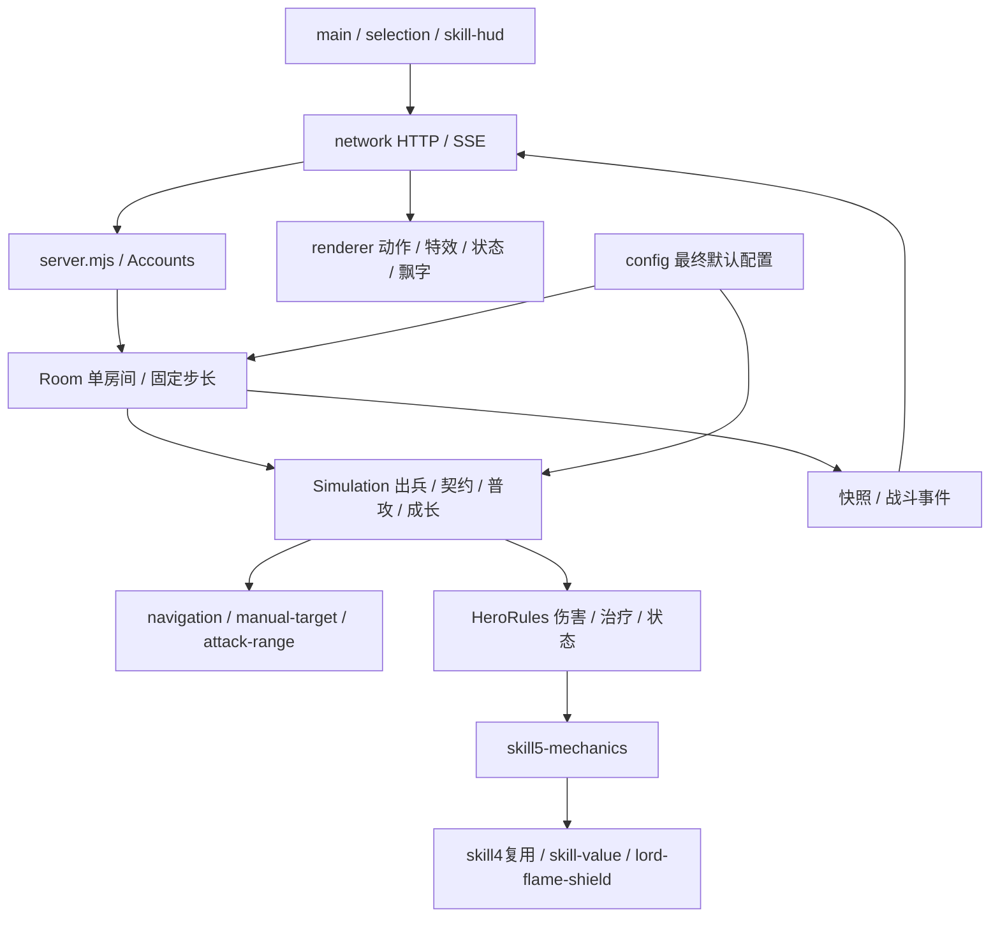

# 代码模块索引

按玩法职责建立逻辑模块，保留原源码路径和运行依赖。跨模块共享的`Simulation`、`HeroRules`和`Room`明确标注，便于后续逐项修改与评审。

| 模块 | 职责 |
|---|---|
| [账号、会话与多人同步](01-accounts-and-network.md) | 注册登录、会话、HTTP命令、SSE、单房间编排、快照还原及重连。 |
| [战场、兵线、阶段与建筑](02-battlefield-and-waves.md) | 地图边界、阶段胜负、单位模板、波次分配、出生、防御塔守护及机器人数量。 |
| [契约、体力、职业成长与评价](03-contracts-and-progression.md) | 点兵确认、职业映射、生命比例继承、技能点、经验归属、体力、贡献、积分和战报。 |
| [自动行动、普攻与手动目标](04-navigation-and-attacks.md) | 自动目标优先级、反击、普通移动、推进边界、20格手选、射程容差与减攻速进度。 |
| [五职业技能、共享额度与持续效果](05-skills-and-budget.md) | 技能计划、目标选择、前摇锁定、20技能释放、共享收益额度、领主光环与灼烧。 |
| [伤害、治疗、状态与归属统计](06-combat-and-statistics.md) | 护甲、易伤、减伤、盾吸、治疗共享、净化免疫、死亡、延迟效果和贡献归属。 |
| [界面、技能HUD与交互文案](07-interface-and-skill-hud.md) | 页面入口、640×1136布局、登录、弹层、技能施放/详情/加点、彩色词条及主题。 |
| [战场渲染、单位动作与技能反馈](08-rendering-and-feedback.md) | Phaser镜头、双方视角、局部动作、轮廓命中、VFX、状态、姓名、光圈和伤害数字。 |
| [配置、迁移与历史兼容](09-configuration-and-compatibility.md) | 最终默认值、基础配置、校验、旧存储迁移、旧范围升级和历史界面兼容文件。 |

## 系统依赖

## 继续阅读

- [全部源码文件、模块归属与直接依赖](source-file-index.md)
- [验证与工具指南](testing-and-tools.md)
- [玩法规则模块](../rules/README.md)
- [数值配置表](../数值配置表.md)
- [开发协作指南](../开发协作指南.md)

服务端模拟20Hz、正常快照约5Hz。客户端负责插值和显示；旧设计兼容代码仍有部分被当前技能复用，阅读时沿实际导入和调用链核对。
